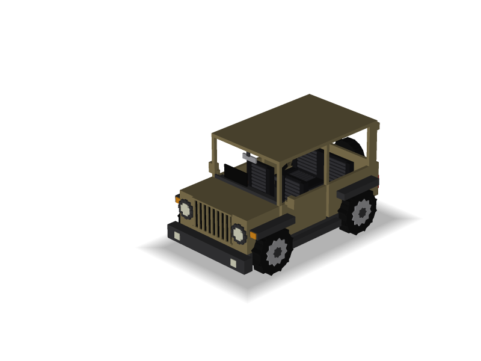
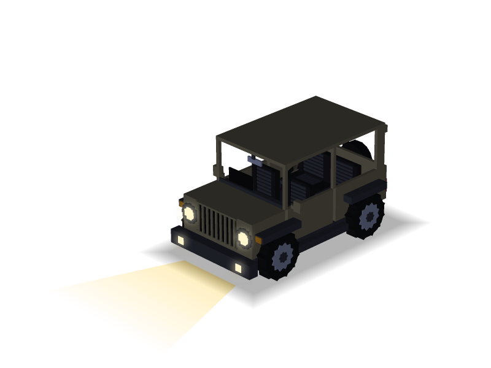
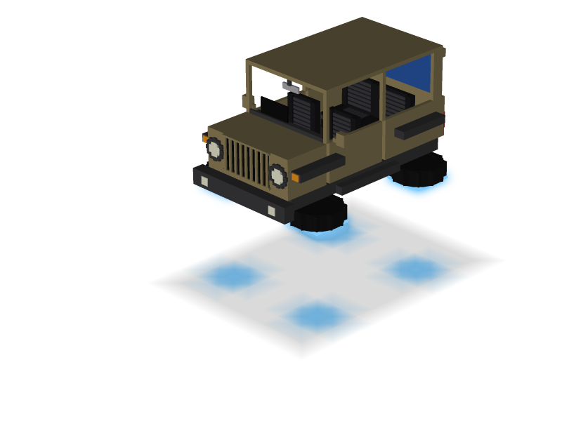

# 🚗 mycar-mod-minecraft

[](https://github.com/yasuflatland-lf/mycar-mod-minecraft/actions/workflows/unit-test.yml)
[](https://github.com/yasuflatland-lf/mycar-mod-minecraft/actions/workflows/integration-test.yml)
[](https://codecov.io/gh/yasuflatland-lf/mycar-mod-minecraft)
[](https://app.codecov.io/gh/yasuflatland-lf/mycar-mod-minecraft/components)
[](LICENSE)

| On the ground | Headlights on | Flying |
|:---:|:---:|:---:|
|  |  |  |

A vehicle add-on for Minecraft Bedrock Edition, inspired by [MrCrayfish's Vehicle Mod](https://www.curseforge.com/minecraft/mc-mods/mrcrayfishs-vehicle-mod). It is built as a Behavior Pack + Resource Pack driven by the stable Script API (`@minecraft/server` 2.x), with no experimental toggles required.

The target setup is a Bedrock Dedicated Server on a home LAN, with players joining from PC (keyboard) and mobile (touch).

## Status

Work in progress. The first milestone is the **driving core**:

- Getting in and out, with a driver seat and passenger seats
- Arcade-style acceleration, inertia, and steering
- Climbing steps up to two blocks high
- Spinning wheels and body tilt
- Ram damage to mobs, while keeping occupants safe
- Placing a vehicle from an item and breaking it back into one
- A free vehicle item for every player on their first join
- Repainting a vehicle green or red by using a dye on it
- Switching the headlights on and off with a switch item, which lights up the road ahead at night

The manual test checklist is in [`docs/manual-test.md`](docs/manual-test.md).

## How to play

### Getting a vehicle

- Every player gets one **SUV** item the first time they join the world
- More can be crafted at a crafting table from 5 iron ingots, 1 iron block, and 2 coal blocks
- Use the item on the top of a block to place the vehicle. Hit an empty vehicle 3 times to break it back into the item
- The **headlight switch** is crafted from a lever and glowstone dust

### Controls

| Action | PC (keyboard) | Mobile (touch) |
|---|---|---|
| Get in | Right-click the vehicle | Tap the vehicle |
| Get out | Shift (sneak) | Sneak button |
| Accelerate / brake and reverse | W / S | Push the stick forward / back |
| Steer | A / D | Push the stick left / right |
| Handbrake (slide) | Space (jump) | Jump button |
| Take off / land | Double-tap Space | Double-tap the jump button |
| Climb / descend while flying | Hold Space / hold S | Hold the jump button / pull the stick back |
| Headlights on / off | Right-click with the switch in hand (driver only) | Tap with the switch in hand (driver only) |
| Repaint | Right-click the vehicle with green or red dye | Tap the vehicle with green or red dye |

The vehicle seats 4. The first player to get in drives and the others ride as passengers. When the driver gets out, a passenger moves up to the driver's seat.

### How it moves

- **Driving.** The vehicle speeds up and coasts like an arcade racer, up to 0.9 blocks per tick (18 blocks per second), and turns as soon as you steer. The handbrake makes it slide sideways. Pushing only sideways (A or D alone, or the stick held flat to one side) creeps forward slowly while turning, instead of backing up
- **Terrain.** It climbs steps up to two blocks high without stopping, and the wheels spin as it rolls
- **Ramming.** It damages and pushes away mobs it hits at speed. People inside never take damage, from crashes or from falls
- **Flying.** A double-tap of jump folds the wheels flat under the body, lights them blue, and lifts the vehicle 1.5 blocks. In the air it keeps the same handling and holds its altitude; hold jump to climb and pull back to sink, while the view stays free to look around. Another double-tap lands it slowly, sinking onto the ground lands it at once, and an empty vehicle in the air sinks to the ground by itself
- **Headlights.** At night they light the road up to 27 blocks ahead and follow the vehicle
- **Paint.** A placed vehicle starts khaki. Green or red dye repaints it and uses one dye; a broken vehicle drops a plain item, so the next one starts khaki again

## Design

Design decisions are recorded as ADRs in [`docs/adr`](docs/adr/README.md). Highlights:

- Movement is script-driven: the script sets the vehicle's velocity every tick ([0002](docs/adr/0002-script-driven-vehicle-movement.md))
- Touch joystick input is scaled so pushing it halfway forward gives full throttle, matching keyboard players, and a stick held sideways turns the vehicle slowly forward instead of reversing ([0018](docs/adr/0018-sideways-stick-creeps-forward.md))
- Code is split into domain, application, and infrastructure layers so the driving logic does not depend on `@minecraft/server` ([0012](docs/adr/0012-ddd-layered-architecture.md))

## Development

Node and pnpm versions are pinned in `mise.toml`. Install [mise](https://mise.jdx.dev/), then run:

```sh
mise install
pnpm install
pnpm lint            # format and lint check with Biome
pnpm test            # unit tests, property-based tests, and the layer dependency check
pnpm build           # bundle the TypeScript into the Behavior Pack
pnpm package         # zip the packs into dist/mycar-<version>.mcaddon (run after build)
pnpm model           # generate the vehicle model, texture, and README preview
pnpm model:check     # fail if the README preview is out of date with the model
pnpm server:up       # start the dev BDS in Docker
pnpm test:game       # in-game tests
```

CI runs the Biome check, the README preview check, type checking, tests, the build, and packaging on every pull request.

## Releasing

Bump the Behavior Pack version in `packs/mycar_bp/manifest.json` and write the release summary in `docs/releases/v<version>.md`, starting from [`docs/releases/TEMPLATE.md`](docs/releases/TEMPLATE.md). Describe what players can do now in plain words; the release workflow puts it above the PR list that GitHub generates, and fails if the file is missing. Merge both to `main`, then either:

- open **Actions → Release → Run workflow** on `main`, which tags the commit as `v<version>` (for example `v0.1.0` for `[0, 1, 0]`), or
- push a matching tag yourself: `git tag v0.1.0 && git push origin v0.1.0`.

The release workflow runs the checks, builds `mycar-<version>.mcaddon`, and attaches it to a new GitHub Release. Opening the file on a device imports both packs into Minecraft.

## License

[MIT](LICENSE)
