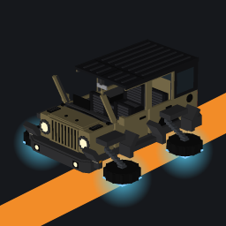
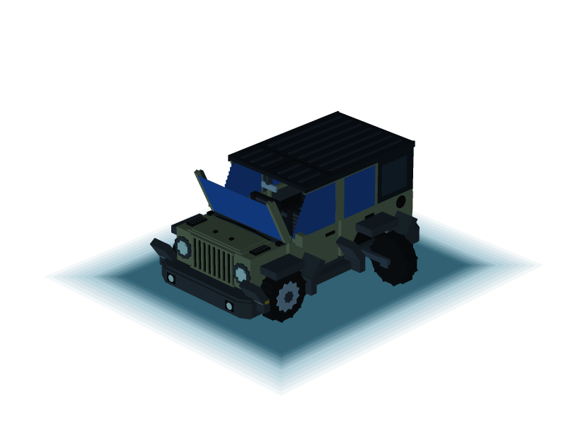

#  Yasuflatland Ride

[](https://github.com/yasuflatland-lf/yasuflatland-ride-minecraft/actions/workflows/unit-test.yml)
[](https://github.com/yasuflatland-lf/yasuflatland-ride-minecraft/actions/workflows/integration-test.yml)
[](https://codecov.io/gh/yasuflatland-lf/yasuflatland-ride-minecraft)
[](https://app.codecov.io/gh/yasuflatland-lf/yasuflatland-ride-minecraft/components)
[](LICENSE)

| On the ground | Headlights on | Flying | Under water |
|:---:|:---:|:---:|:---:|
|  |  |  |  |

A vehicle add-on for Minecraft Bedrock Edition. It is built as a Behavior Pack + Resource Pack driven by the stable Script API (`@minecraft/server` 2.x), with no experimental toggles required.

This add-on holds only rides: the SUV now and boats later. House-building parts will ship as a separate add-on with their own namespace. The `yasu_ride` namespace never changes once Yasuflatland Ride is first released ([ADR 0047](docs/adr/0047-rename-to-yasuflatland-ride.md)).

The target setup is a Bedrock Dedicated Server on a home LAN, with players joining from PC (keyboard) and mobile (touch).

## Status

The [latest release](https://github.com/yasuflatland-lf/yasuflatland-ride-minecraft/releases/latest) has one vehicle, the **SUV**, that drives, flies, and dives:

- Getting in and out, with a driver seat and three passenger seats; a passenger moves up when the driver gets out
- Arcade-style acceleration, inertia, steering, and a handbrake slide, tuned so touch players get full throttle like keyboard players
- Climbing steps up to two blocks high
- Spinning wheels, body tilt, muffler smoke, and engine and wind sounds
- Ram damage to mobs, while keeping occupants safe from crashes and falls
- Flying: the wheels fold out on arms, the body banks into turns, and the camera pulls back to third person
- Diving: deep water turns the SUV into a submarine with sealed windows, bronze propellers, a sonar ping, and unlimited air
- Placing a vehicle from an item and breaking it back into one
- At most 10 vehicles per world: placing an eleventh removes the oldest
- A free vehicle item for every player on their first join, and a crafting recipe for more
- Repainting a vehicle with any of the 16 dyes
- Switching the headlights on and off with a switch item, which lights up the road ahead at night

The manual test checklist is in [`docs/manual-test.md`](docs/manual-test.md).

## Installing

Download `yasuflatland-ride-<version>.mcaddon` from the [latest release](https://github.com/yasuflatland-lf/yasuflatland-ride-minecraft/releases/latest). Players who join a server that already has the packs do not need to install anything: the server sends the Resource Pack when they join, so accept the download prompt.

### On iPad

1. **Download it in Safari.** Open the [latest release](https://github.com/yasuflatland-lf/yasuflatland-ride-minecraft/releases/latest), tap `yasuflatland-ride-<version>.mcaddon` under Assets, and choose **Download**. It is saved to the Downloads folder in the Files app.
2. **Open it in Minecraft.**
   - In the Files app, long-press the file and choose **Share → Minecraft**.
   - Minecraft starts and shows "Import started..." and then "Successfully imported" at the top of the screen.
   - If the file name ends in `.zip`, iOS has changed the extension. Long-press it, choose **Rename**, change it back to `.mcaddon`, and share it again.
   - If Minecraft is not in the share sheet, look under **More** at the right end of the app row.
3. **Turn it on in a world.**
   - Open **Edit** on a world, or **Create New** for a new one.
   - Under **Behavior Packs → Available**, activate **Yasuflatland Ride**. **Yasuflatland Ride Resources** is activated along with it.
   - Leave the experiments off; none are needed.

## How to play

### Getting a vehicle

- Every player gets one **SUV** item the first time they join the world
- More can be crafted at a crafting table from 5 iron ingots, 1 iron block, and 2 coal blocks
- Use the item on the top of a block to place the vehicle. Hit an empty vehicle 3 times, without a dye in hand, to break it back into the item
- The **headlight switch** is crafted from a lever and glowstone dust

### Controls

| Action | PC (keyboard) | Mobile (touch) |
|---|---|---|
| Get in | Right-click the vehicle | Press the ride button |
| Get out | Shift (sneak) | Sneak button |
| Accelerate / brake and reverse | W / S | Push the stick forward / back |
| Steer | A / D | Push the stick left / right |
| Handbrake (slide) | Space (jump) | Jump button |
| Take off / land | Double-tap Space | Double-tap the jump button |
| Climb / descend while flying | Hold Space / hold S | Hold the jump button / pull the stick back |
| Dive | Drive into water at least as deep as the vehicle is tall | Drive into water at least as deep as the vehicle is tall |
| Rise / sink under water | Hold Space / hold S | Hold the jump button / pull the stick back |
| Surface and fly | Hold Space until the body is out of the water | Hold the jump button until the body is out of the water |
| Leave the water | Drive onto the shore | Drive onto the shore |
| Headlights on / off | Right-click with the switch in hand (driver only) | Tap with the switch in hand (driver only) |
| Repaint | Left-click the vehicle with a dye | Tap the vehicle with a dye |

The vehicle seats 4. The first player to get in drives and the others ride as passengers. When the driver gets out, a passenger moves up to the driver's seat.

### How it moves

- **Driving.** The vehicle speeds up and coasts like an arcade racer, up to 0.9 blocks per tick (18 blocks per second), and turns as soon as you steer. The handbrake makes it slide sideways. Pushing only sideways (A or D alone, or the stick held flat to one side) creeps forward slowly while turning, instead of backing up
- **Terrain.** It climbs steps up to two blocks high without stopping, and the wheels spin as it rolls
- **Ramming.** It damages and pushes away mobs it hits at speed. People inside never take damage, from crashes or from falls
- **Flying.** A double-tap of jump folds the wheels flat under the body, lights them blue, and lifts the vehicle 1.5 blocks. In the air it keeps the same handling, banks into turns like an airplane, and holds its altitude; hold jump to climb and pull back to sink, while the view stays free to look around. Another double-tap lands it slowly, sinking onto the ground lands it at once, and an empty vehicle in the air sinks to the ground by itself
- **Under water.** Driving into water at least as deep as the vehicle is tall turns it into a submarine: the windows seal blue, the rear wheels turn backward on gunmetal arms around spinning bronze propellers, and a sonar ping sounds while someone rides. It keeps the flying handling and banks into turns, holds its depth, and rises or sinks with jump and pull-back. Riders do not lose air. Hold jump until the whole body is out of the water to take off, or drive onto a shore to become a car again; an empty submarine floats up to the surface
- **Headlights.** At night they light the road up to 27 blocks ahead and follow the vehicle
- **Paint.** A placed vehicle starts khaki. Each of the 16 dyes repaints it in that dye's color, except brown dye, which turns it back to khaki; each repaint uses one dye. Ink sacs, bone meal, cocoa beans, and lapis lazuli do not repaint. a broken vehicle drops a plain item, so the next one starts khaki again

## Design

Design decisions are recorded as ADRs in [`docs/adr`](docs/adr/README.md). Highlights:

- Movement is script-driven: the script sets the vehicle's velocity every tick ([0002](docs/adr/0002-script-driven-vehicle-movement.md))
- Touch joystick input is scaled so pushing it halfway forward gives full throttle, matching keyboard players, and a stick held sideways turns the vehicle slowly forward instead of reversing ([0018](docs/adr/0018-sideways-stick-creeps-forward.md))
- Code is split into domain, application, and infrastructure layers so the driving logic does not depend on `@minecraft/server` ([0012](docs/adr/0012-ddd-layered-architecture.md))

## Development

Node and pnpm versions are pinned in `mise.toml`. Install [mise](https://mise.jdx.dev/), then run:

```sh
mise install
pnpm install
pnpm lint            # format and lint check with Biome
pnpm test            # unit tests, property-based tests, and the layer dependency check
pnpm build           # bundle the TypeScript into the Behavior Pack
pnpm package         # zip the packs into dist/yasuflatland-ride-<version>.mcaddon (run after build)
pnpm model           # generate the vehicle model, texture, README previews, and pack icons
pnpm model:check     # fail if the README previews or pack icons are out of date with the model
pnpm server:up       # start the dev BDS in Docker
pnpm test:game       # in-game tests
```

CI runs the Biome check, the README preview and pack icon check, type checking, tests, the build, and packaging on every pull request.

The dev world starts fresh as `yasuflatland-ride-dev`. The world from before the rename can be deleted by hand; its path is recorded in [ADR 0047](docs/adr/0047-rename-to-yasuflatland-ride.md). Before your first `pnpm server:up` after the rename, remove the dev container from before the rename once, since it still holds the server ports: find its name with `docker ps -a`, then run `docker rm -f <name>`.

After the stack merges, the owner will rename the GitHub repository to `yasuflatland-ride-minecraft` and check the Codecov badge. The links above use that destination.

## Releasing

Bump the Behavior Pack version in `packs/yasu_ride_bp/manifest.json` and write the release summary in `docs/releases/v<version>.md`, starting from [`docs/releases/TEMPLATE.md`](docs/releases/TEMPLATE.md). Describe what players can do now in plain words; the release workflow puts it above the PR list that GitHub generates, and fails if the file is missing. The Resource Pack depends on the Behavior Pack version, so update that dependency in `packs/yasu_ride_rp/manifest.json` too; this changes the Resource Pack, so also bump its version and the Behavior Pack's dependency on it (ADR 0015). `tests/packs/resourcePack.test.ts` fails if the Resource Pack's dependency differs from the Behavior Pack version, or if the Behavior Pack's dependency differs from the Resource Pack version; it cannot tell whether the Resource Pack version was bumped, so check that yourself. Merge these changes to `main`, then either:

- open **Actions → Release → Run workflow** on `main`, which tags the commit as `v<version>` (for example `v0.1.0` for `[0, 1, 0]`), or
- push a matching tag yourself: `git tag v0.1.0 && git push origin v0.1.0`.

The release workflow runs the checks, builds `yasuflatland-ride-<version>.mcaddon`, and attaches it to a new GitHub Release. Opening the file on a device imports both packs into Minecraft.

## Upgrading from MyCar 0.5.0 and earlier

Switch the headlights off before upgrading. Old vehicles and items disappear because their IDs are not migrated. Light blocks from a vehicle whose headlights are on remain in the world: the record of lit cells lives on the vanished entity.

The fleet record starts empty, and every player receives the starter vehicle again on their next join. Get additional vehicles with `/give @s yasu_ride:suv_item` or the recipe. Pack UUIDs stay the same, so worlds that already list the packs load the new versions.

On a dedicated server, delete the old MyCar pack folders from `behavior_packs` and `resource_packs` (the ones ending in `_bp` and `_rp` that predate `yasu_ride_bp` and `yasu_ride_rp`) before you copy in the new ones. The old and new folders share UUIDs, so keeping both leaves the server with two packs under one UUID.

## License

[MIT](LICENSE)
